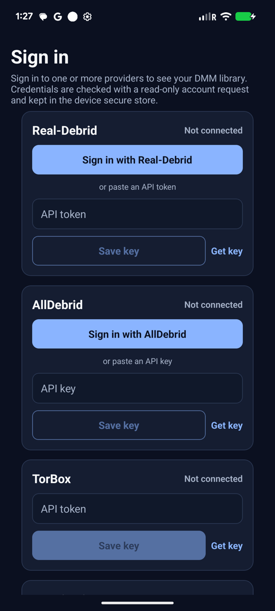
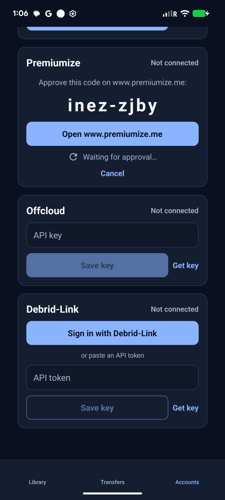
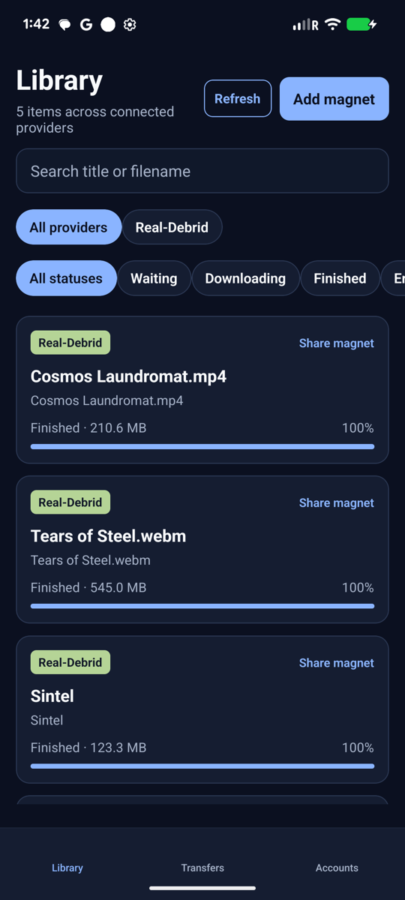
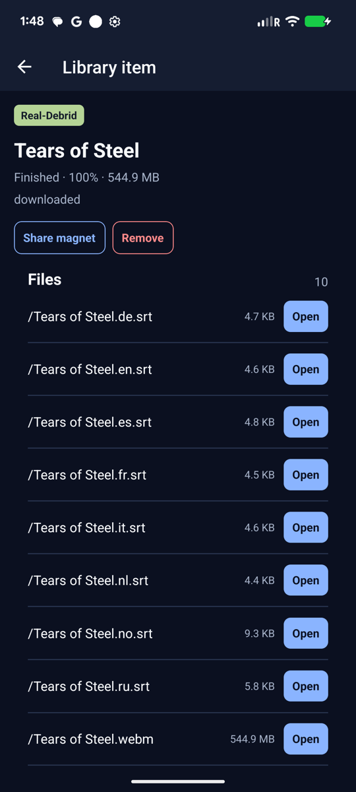
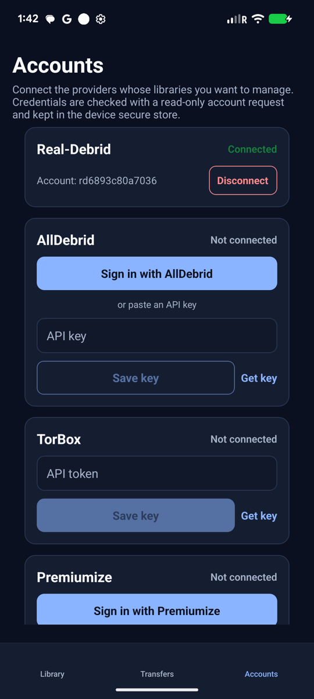

# DMM Library for iOS and Android

This standalone Expo app manages a user's existing DMM library directly from
native iOS and Android screens. It talks to each provider from the device; the
DMM web app and its server-side session are not required.

## Local development

```sh
npm ci
npm run typecheck
npm test
npm start
```

Install the repository's lightweight pre-commit checks once per checkout:

```sh
git config core.hooksPath .githooks
```

Use the Expo development build or simulator commands after the native toolchain
is installed:

```sh
npm run ios
npm run android
```

A release APK that runs without Metro (Java 17 and the Android SDK required):

```sh
npx expo prebuild -p android
cd android && ./gradlew :app:assembleRelease -PreactNativeArchitectures=arm64-v8a
```

`npm run export:web` is a browser preview of the same screens. It is useful for
layout checks, but it does not prove native device behavior; browser previews do
not persist credentials because SecureStore is a native-only facility. The app
does not use a WebView, paid EAS builds, signing, or store publication.

## Signing in

The app opens on a sign-in screen until at least one provider is connected.

| Provider | Sign-in | Paste a key |
|---|---|---|
| Real-Debrid | Device code (OAuth); the token renews itself every 24 hours | API token |
| AllDebrid | PIN, which hands back an API key | API key |
| Premiumize | Device code (OAuth); the token lasts ten years | API key |
| Debrid-Link | Device code (OAuth); the token renews itself daily | API token |
| TorBox | none offered by TorBox | API key |
| Offcloud | none offered by Offcloud | API key |

"Sign in with …" shows a short code and opens the provider's approval page in
the browser; the app finishes on its own once the code is approved. The client
ids are the public ones DMM web uses, and the app calls the providers directly.
Every credential is checked with a read-only account request before it is
saved, and free or lapsed accounts are refused the way DMM web refuses them
(TorBox free plan, non-premium Premiumize, Offcloud and Debrid-Link).

Credentials are kept only in the platform secure store. Disconnecting a
provider deletes its secure-store item and invalidates outstanding requests
before clearing that provider's library rows.

## Library

One list across every connected provider, with search, provider and status
filters, sorting, pull to refresh, adding a magnet, and a detail screen with the
files. Download links are resolved only after a user taps a file and are handed
to the operating system; credential-bearing links are never shared. Magnets can
be shared through the native share sheet.

## Screenshots

Pixel 6, Android 16, release build.

<p>





</p>

The library shows Blender open movies (CC BY) on a test account.

### Tested on the device (2026-11-09)

| Provider | Result |
|---|---|
| Real-Debrid | Device sign-in approved in the browser, library, add magnet, file selection, open a file |
| Premiumize | Device sign-in approved, library |
| Debrid-Link | Device sign-in approved (the delete scope is listed), library |
| AllDebrid | Pasted key and library; the PIN is created and shown on AllDebrid's page, approval not completed in this test |
| TorBox | Pasted key and library; a free-plan key is refused |
| Offcloud | Pasted key, library, provider filter, open a file (sizes show as unknown: Offcloud's history and file list carry none) |

This project is distributed under AGPL-3.0-only. See `LICENSE` and `NOTICE.md`.

For a populated preview without provider credentials, use the [fixture QA entry](qa/README.md) in a separate checkout.

An embedded player, background downloads and store distribution are outside
this release. The pinned Expo CLI has five moderate transitive development-tool
advisories; no incompatible forced dependency downgrade was applied.
