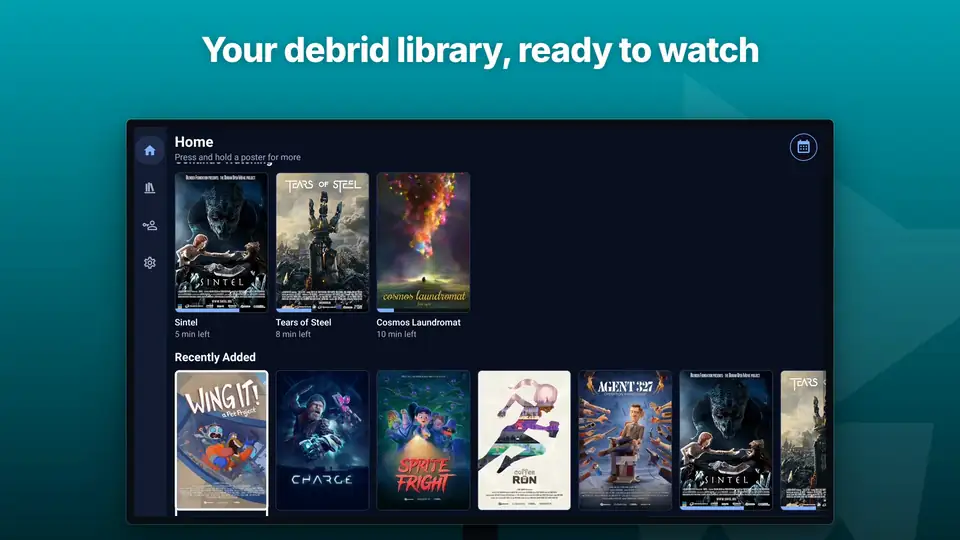
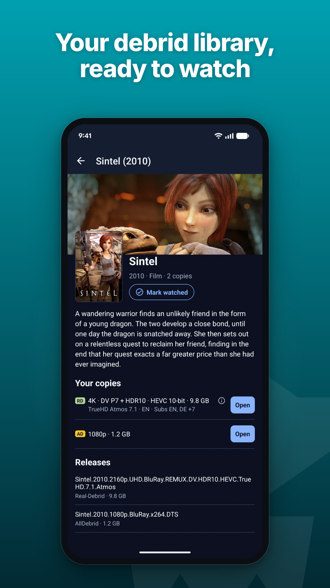
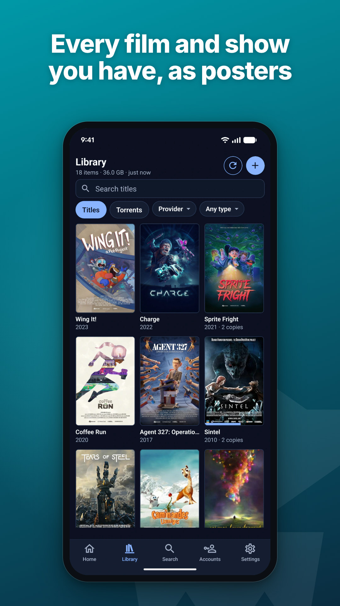
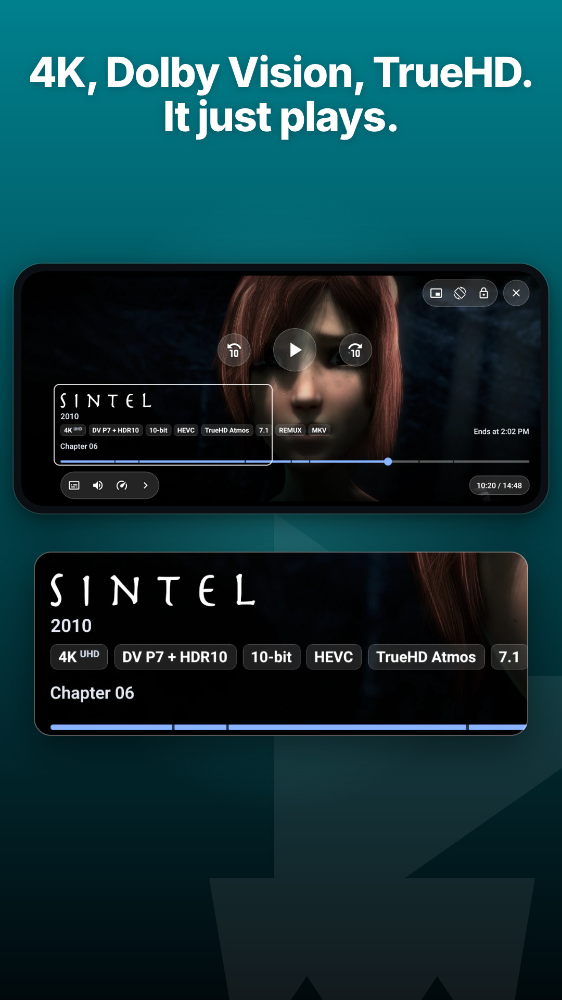
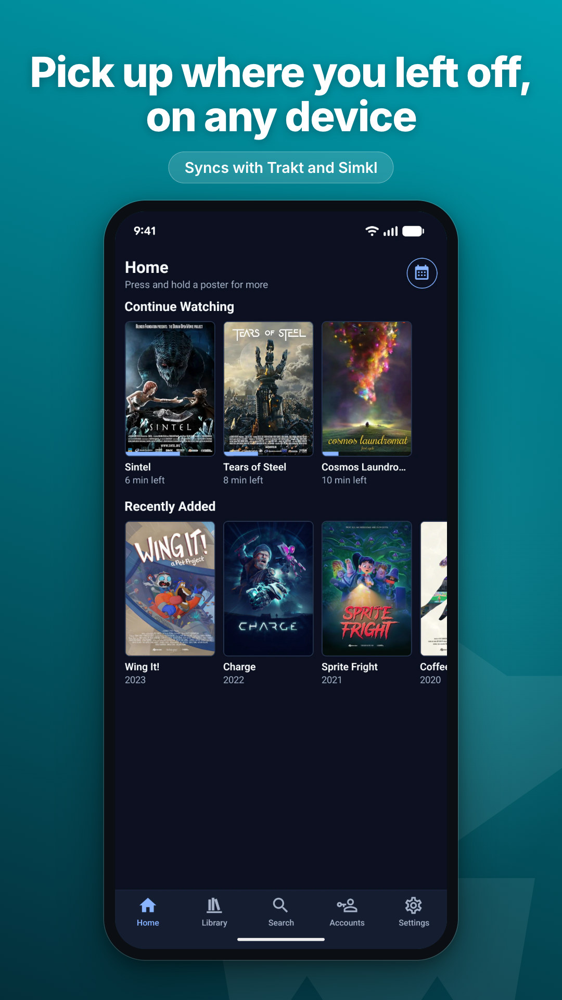
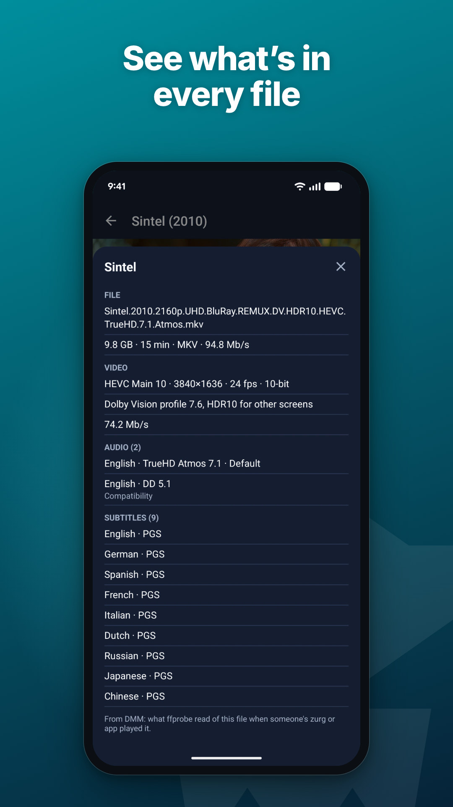
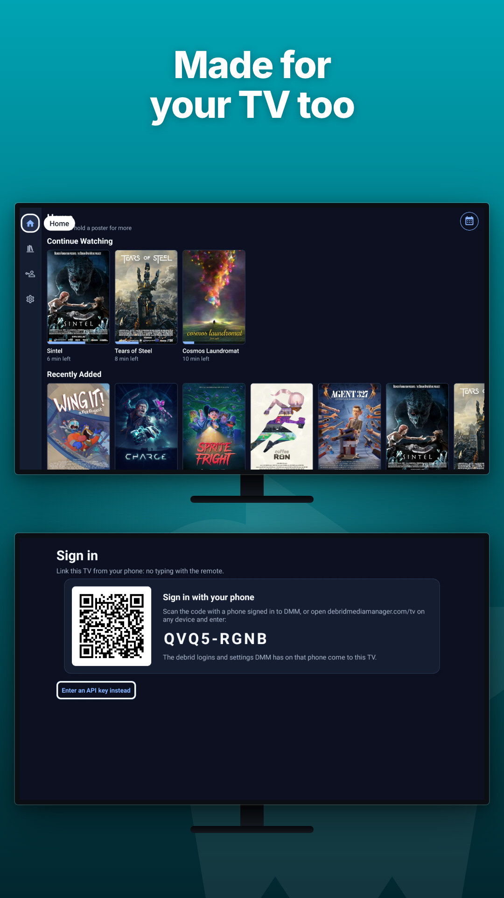
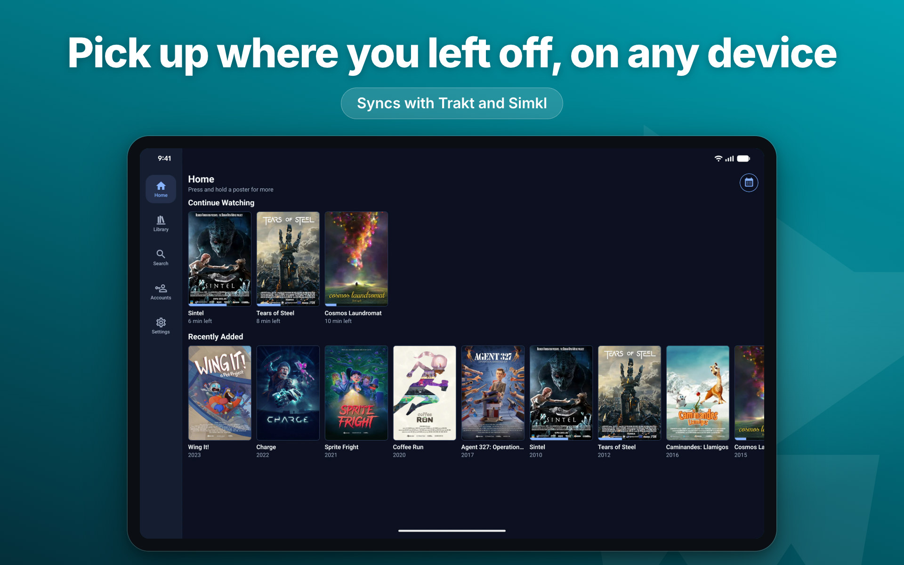
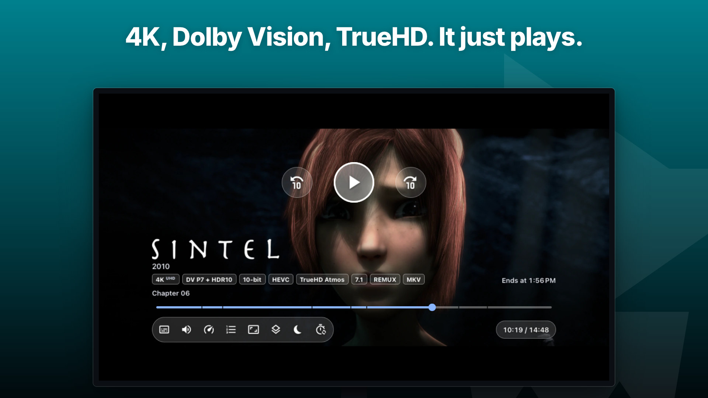

<p align="center"></p>

<h1 align="center">DMM Mobile</h1>

<p align="center"><b>Your debrid library, ready to watch.</b><br>On your phone, tablet and TV.</p>

<p align="center">
  <a href="#get-it">Download</a> ·
  <a href="docs/features.md">Features</a> ·
  <a href="https://debridmediamanager.com/">Website</a> ·
  <a href="https://discord.com/invite/7u4YjMThXP">Discord</a> ·
  <a href="https://www.reddit.com/r/debridmediamanager/">Reddit</a>
</p>

<p align="center"><a href="https://youtu.be/k-ZhwzHk4FE"></a></p>
<p align="center"><sub>DMM Mobile on a Fire TV, with Blender's open movies. <a href="https://youtu.be/k-ZhwzHk4FE">Watch the full preview on YouTube</a>.</sub></p>

Your debrid account as a library you can browse and play. The phone and TV app of
[Debrid Media Manager](https://debridmediamanager.com/): free, no ads, and it talks to your
debrid service straight from your device.

## Get it

- **Google Play** (Android phones, tablets and TVs): in a closed test for now.
  [Join the testers group](https://groups.google.com/g/dmm-mobile-beta), then
  [become a tester](https://play.google.com/apps/testing/com.debridmediamanager.library)
  and install DMM Mobile from Play.
- **APK** for any Android phone, tablet, Android TV or Fire TV:
  [download the latest release](https://github.com/debridmediamanager/dmm-mobile/releases/latest).
  One file fits them all; on a Fire TV, sideload it.
- **App Store** (iPhone, iPad, Apple TV) and **Amazon Appstore** (Fire TV): in review, coming soon.

No debrid account yet? Enter `dmmdemo` as any service's API key to look around a sample
library of open movies.

## Features

- **Your library as posters.** Every film and show you have, each one once, with seasons and episodes.
- **A player that just plays.** 4K, HDR and Dolby Vision files, TrueHD Atmos and DTS-HD sound, chapters, subtitles, speed and a sleep timer.
- **Your choice of player.** Picture in picture on Android phones and tablets, or hand videos to the player app you like.
- **Continue Watching and Next Up.** Pick up where you stopped, and the next episode is ready.
- **Trakt and Simkl.** What you play is scrobbled; watched marks and resume points follow you to every device.
- **Your lists.** Trakt and Simkl watchlists and lists, with what your library already holds ready to play.
- **Calendar.** New episodes of your shows, with an optional alert when one airs (phones and tablets).
- **See what's in every file.** Resolution, HDR or Dolby Vision, every audio and subtitle track.
- **Keep it tidy.** Search, filter and sort thousands of items, add magnets and `.torrent` files, clear out duplicates, back up and restore.
- **Six debrid services.** Real-Debrid, AllDebrid, TorBox, Premiumize, Offcloud and Debrid-Link.
- **Made for your TV.** Android TV, Fire TV and Apple TV, all with the remote. Sign in by scanning a code with your phone.
- **Sign in once.** Your other services and settings come back on every device, DMM on the web included.

<p>
  
  
  
</p>
<p>
  
  
  
</p>
<p>
  
  
</p>

Every feature in detail, with more screenshots: [docs/features.md](docs/features.md).

## Platforms

| | Phones and tablets | TV |
|---|---|---|
| Android | Android 7.0 or newer | Android TV, Fire TV |
| Apple | iPhone and iPad, iOS 16.4 or newer | Apple TV, tvOS 16.4 or newer |

## Privacy

Your debrid logins stay in your device's secure storage, and the app talks to your
services directly. DMM gets your releases' names and hashes (to tell which film or show
each one is and what's in its files) and your searches, which it doesn't keep. It also keeps
your logins and settings so they come back on your other devices, so don't sign in with a
shared debrid account. Trakt and Simkl get your watch history only if you connect them. [Privacy policy](https://debridmediamanager.com/privacy).

## Development

```sh
npm ci
npm run typecheck
npm test
vlckit/fetch.sh                          # once, before an iPhone, iPad or Apple TV prebuild
npx expo prebuild -p ios                 # EXPO_TV=1 for Apple TV
EXPO_TV=1 npx expo prebuild -p android   # one APK for phones, tablets and TVs
```

Building, the player's VLCKit and the fixture preview: [docs/development.md](docs/development.md).
Releases and over-the-air updates: [docs/releasing.md](docs/releasing.md) and [docs/store/release.md](docs/store/release.md).

## Licence

AGPL-3.0-only, see [LICENSE](LICENSE). [NOTICE.md](NOTICE.md) covers what the app is
built from, including the VLCKit build with the TrueHD decoder switched back on.

**More from DMM:** [Debrid Media Manager](https://debridmediamanager.com/) · [zurg](https://zurg.debridmediamanager.com/) · [rex](https://rex.debridmediamanager.com/) · [Docs](https://notes.debridmediamanager.com/) · [Sponsor](https://gatekeeper.debridmediamanager.com/) · [Discord](https://discord.com/invite/7u4YjMThXP) · [Reddit](https://www.reddit.com/r/debridmediamanager/)
