# DMM Mobile for phones, tablets and TVs

This standalone Expo app manages a user's existing DMM library directly from
native screens on iPhone, iPad, Apple TV, Android phones and tablets, and
Android TV / Fire TV. It talks to each provider from the device; the
DMM web app and its server-side session are not required.

## Local development

```sh
npm ci
npm run typecheck
npm test
npm start
```

Install the repository's lightweight pre-commit checks once per checkout:

```sh
git config core.hooksPath .githooks
```

Use the Expo development build or simulator commands after the native toolchain
is installed:

```sh
npm run ios
npm run android
```

The app is built on `react-native-tvos`, React Native's TV fork, which also
builds phones. One Android APK serves phones, tablets and TVs; prebuild it with
`EXPO_TV=1` so the manifest gets the TV launcher entry and banner (Java 17 and
the Android SDK required). Fire TV is 32-bit, hence `armeabi-v7a`:

```sh
EXPO_TV=1 npx expo prebuild -p android
cd android && ./gradlew :app:assembleRelease -PreactNativeArchitectures=arm64-v8a,armeabi-v7a
```

Apple builds one project per platform: `npx expo prebuild -p ios` for iPhone
and iPad, `EXPO_TV=1 npx expo prebuild -p ios` for Apple TV. `package.json`
overrides `react-native` for every package: the fork's own list component asks
for stock React Native, and two copies in one bundle leave the app unable to start.

`npm run export:web` is a browser preview of the same screens. It is useful for
layout checks, but it does not prove native device behavior; browser previews do
not persist credentials because SecureStore is a native-only facility. The app
does not use a WebView or paid EAS builds.

Installed builds take JavaScript fixes over the air from our own update server,
signed with our own key; native changes ship as store releases. Both are in
[docs/releasing.md](docs/releasing.md).

## Store releases

App Store and Google Play releases follow [docs/store/release.md](docs/store/release.md);
the listing copy and form answers are in [listing.md](docs/store/listing.md), and the
reviewer sign-in and test checklist in [review.md](docs/store/review.md). Reviewers
sign in with the demo key `dmmdemo`, which works as any provider's API key and opens a
sample library of open movies without a debrid account.

## Signing in

The app opens on a sign-in screen until at least one provider is connected.

On a TV the sign-in is a QR code, as for DMM's Kodi addon: scan it with a
phone signed in to DMM (or open debridmediamanager.com/tv and type the code),
approve, and that browser's debrid logins and settings come to the TV. Phones
and tablets sign in per provider:

| Provider | Sign-in | Paste a key |
|---|---|---|
| Real-Debrid | Device code (OAuth); the token renews itself every 24 hours | API token |
| AllDebrid | PIN, which hands back an API key | API key |
| Premiumize | Device code (OAuth); the token lasts ten years | API key |
| Debrid-Link | Device code (OAuth); the token renews itself daily | API token |
| TorBox | none offered by TorBox | API key |
| Offcloud | none offered by Offcloud | API key |

"Sign in with …" shows a short code and opens the provider's approval page in
the browser; the app finishes on its own once the code is approved. The client
ids are the public ones DMM web uses, and the app calls the providers directly.
Every credential is checked with a read-only account request before it is
saved, and free or lapsed accounts are refused the way DMM web refuses them
(TorBox free plan, non-premium Premiumize, Offcloud and Debrid-Link).

Credentials are kept only in the platform secure store. Disconnecting a
provider deletes its secure-store item and invalidates outstanding requests
before clearing that provider's library rows.

## Library

The library opens on **Titles**: your films and shows as posters, each one
once however many releases and providers hold it. DMM names each release (its
library identification, the answers DMM web's library page uses; the app proves
one of its provider logins to ask), and the phone remembers the answers, so a
refresh asks only about new releases. A film's page lists your copies with Open;
a show's page lists its seasons and the episodes you have, each copy with Open,
reading episode numbers from the file names (SxxEyy, 1x02, a season folder or
the release's one season). Files with nothing to go by, such as absolute anime
numbering or extras, stay on the show's page under "Not placed". Releases DMM
cannot name stay below the posters as Other. Only what is in your library shows:
finding new releases stays on DMM web.

**Torrents** is the library page of DMM web, on the phone. One dense list across every
connected provider, one row per item, built for libraries of thousands
(measured with 7,205 items on a Pixel 6: a full refresh of six providers in
about 6 s, smooth scrolling, search under a second per keystroke).

- **Search** like DMM web: every word must match the name (as a pattern), an
  id, a provider prefix such as `rd:`, an info hash or a provider status.
- **Filters**: provider, movies / TV / other, and the web's views (in
  progress, slow, failed, uncached, names Real-Debrid blocks, same hash, same
  title, selected). Sort by newest, oldest, title, size or progress.
- **Rows** show the provider, size, type, date, progress and speed, and how many
  copies share the hash or title; a row's ⋯ menu opens just that group, and has
  the row's own actions.
- **Selection and bulk actions**: long press selects. Actions take the
  selection, or everything shown when nothing is selected: reinsert, delete,
  share a hash list, back up, delete duplicates (keep the bigger, smaller,
  newer or older) and merge copies of one hash.
- **Add** magnets, info hashes (Debrid-Link only when cached), `.torrent` files
  and, on TorBox, web links. `magnet:` links and `.torrent` files opened from
  other apps (Open with, a browser download) land in Add, on the provider used last.
- **Backup and restore** use DMM web's `.dmm.json`, so either side restores the
  other's; TorBox and AllDebrid can restore only what is cached.
- **Item detail**: files, open a file in another app, share its links, reinsert
  (Real-Debrid; active TorBox torrents; failed AllDebrid magnets), and choose
  Real-Debrid files, including on a finished torrent.

Download links are resolved only after a user taps a file. Videos open in the
player chosen in Settings (VLC, MX Player, Just Player or Android's app
picker; Infuse, VLC, VidHub, Outplayer, SenPlayer or Aether on iOS), the same
list DMM web offers; other files go to the operating system. Hash lists open on DMM web's `/hashlist` page, carried
in the link itself.

## Search

DMM web's quick search on its own tab: the six best movie and show matches,
then up to three anime. A row opens that title's page on DMM in the phone's
browser, already signed in with the app's logins: the app hands them to DMM
behind a one-time code that lives two minutes, carried in the link's `#`
fragment, which never reaches a server. A browser that is already signed in to
DMM keeps its own login. Pasting an IMDb id opens that title directly.

## Remembered across devices

Always on. The app keeps your logins and settings in DMM's "remember my logins
and settings across devices" store, behind each provider login, in DMM web's own
format. Sign in to one provider (in the app or on DMM web with that option
ticked) and the other logins and settings come back; keys DMM web keeps that the
app does not use are saved back untouched. Anyone who can sign in to one of
those accounts gets all of them, so keep shared debrid accounts out of the app.
Settings (video player, the provider adds start on) use DMM web's
`settings:player` and `settings:addMagnetProvider`.

Not in the app, because they need DMM's servers: casting to Stremio, sending
to Real-Debrid through DMM's uploader and the media info panel.

## Tablets and TVs

On a tablet or TV the tabs become a rail on the left and sheets float in the
middle. On a TV everything is reached with the remote: the focused control is
outlined, Select opens a text field's keyboard (Android TV otherwise keeps the
remote inside a focused field), and the dark theme is always on. Apple TV draws
the Android TV layout at twice the size, so both look the same. What a TV has
no way to do is left out: sharing, file pickers, opening links in a browser,
and so the Search tab.
On Apple TV videos go to a player app chosen in Settings (Infuse, VLC and the
rest of DMM web's list).

## Screenshots

Release builds, full resolution (click one to open it). The libraries show Blender
open movies (CC BY) from a screenshot fixture of the real screens; search results
are DMM's live search; the two sign-in screens are the app as it ships.

### Phones

Pixel 6 (Android 16) and iPhone 17 Pro simulator (iOS 26.5).

<p>
<a href="docs/screenshots/android-phone-library.png">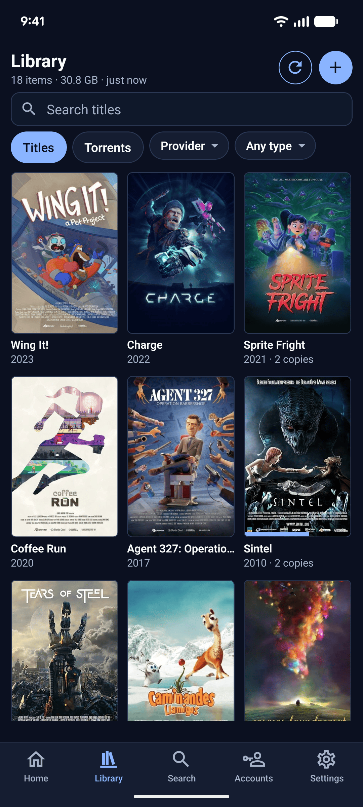</a>
<a href="docs/screenshots/android-phone-search.png">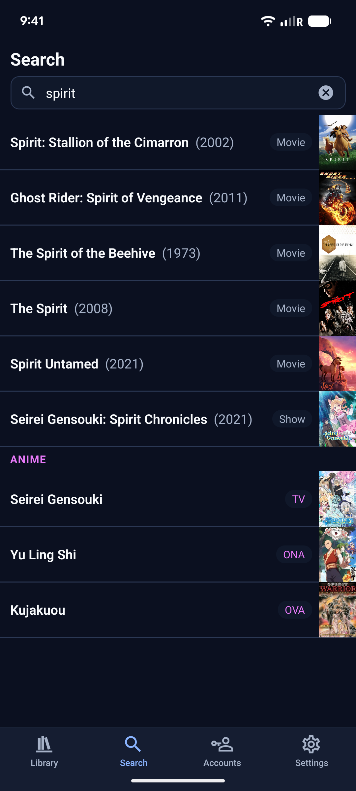</a>
<a href="docs/screenshots/android-phone-detail.png">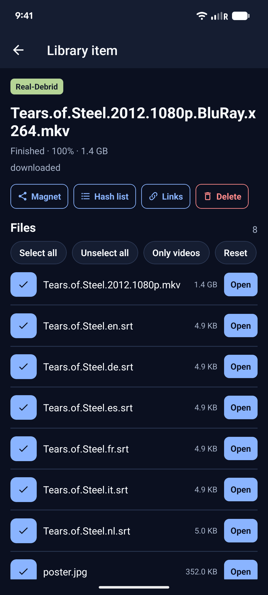</a>
<a href="docs/screenshots/android-phone-menu.png">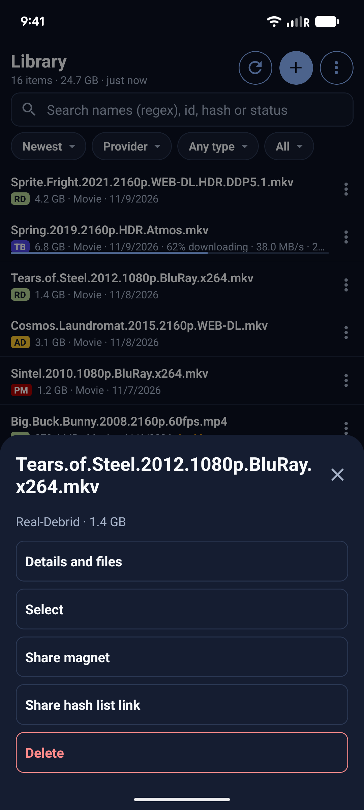</a>
<a href="docs/screenshots/iphone-library.png">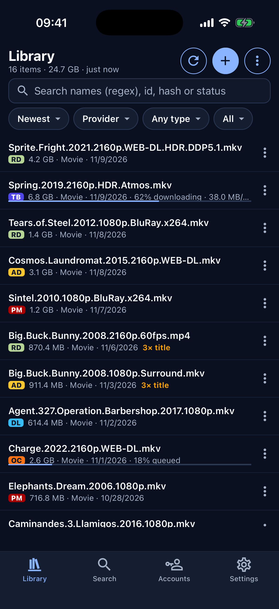</a>
<a href="docs/screenshots/iphone-search.png">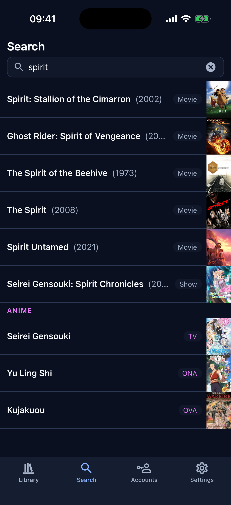</a>
<a href="docs/screenshots/iphone-sign-in.png">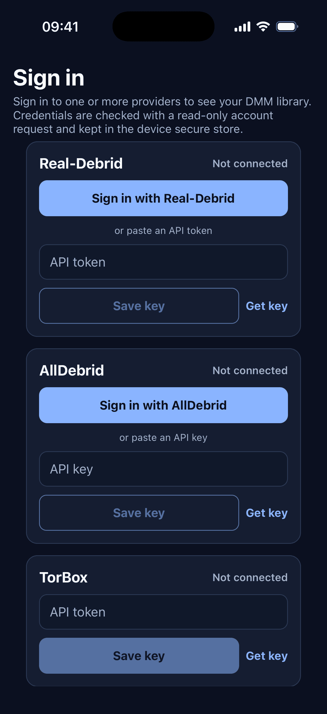</a>
</p>

### Tablets

Pixel 6 set to a 10-inch tablet's screen (2560×1600) and iPad Pro 13-inch simulator.
The tabs become a rail on the left.

<p>
<a href="docs/screenshots/android-tablet-library.png">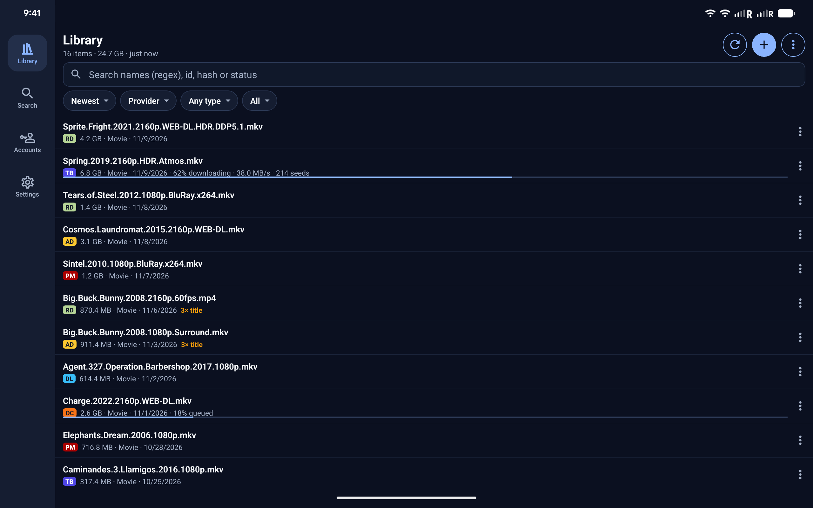</a>
<a href="docs/screenshots/android-tablet-search.png">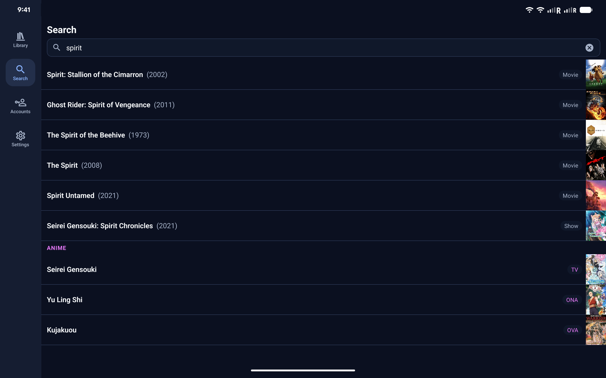</a>
<a href="docs/screenshots/ipad-library.png">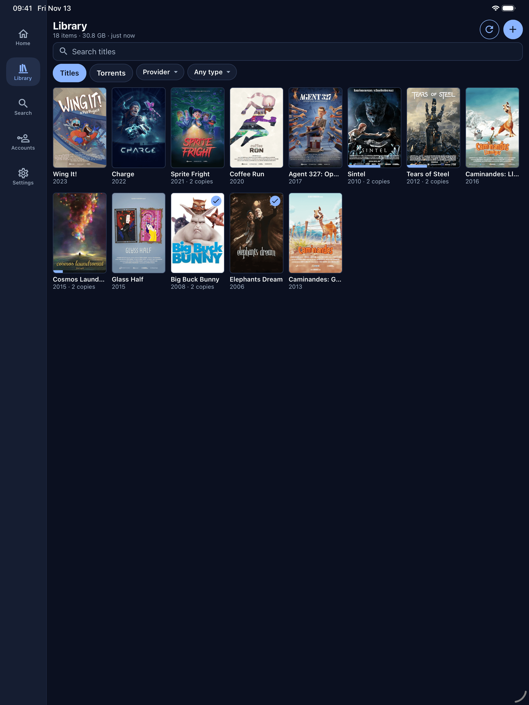</a>
<a href="docs/screenshots/ipad-search.png">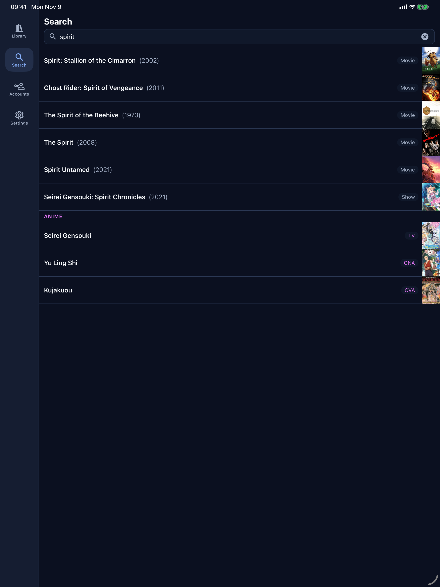</a>
</p>

### TVs

Fire TV Cube (Fire OS 7, 1080p) and Apple TV 4K simulator (tvOS 26.5, 4K). The
focused control is outlined; a TV signs in by scanning a QR code with a phone.
TVs have no Search tab, since a TV has no browser to open results in.

<p>
<a href="docs/screenshots/firetv-sign-in.png">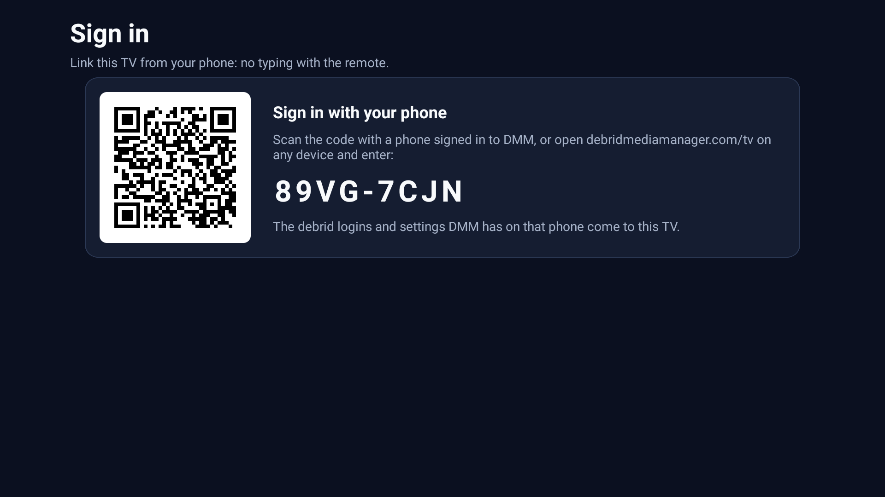</a>
<a href="docs/screenshots/firetv-library.png">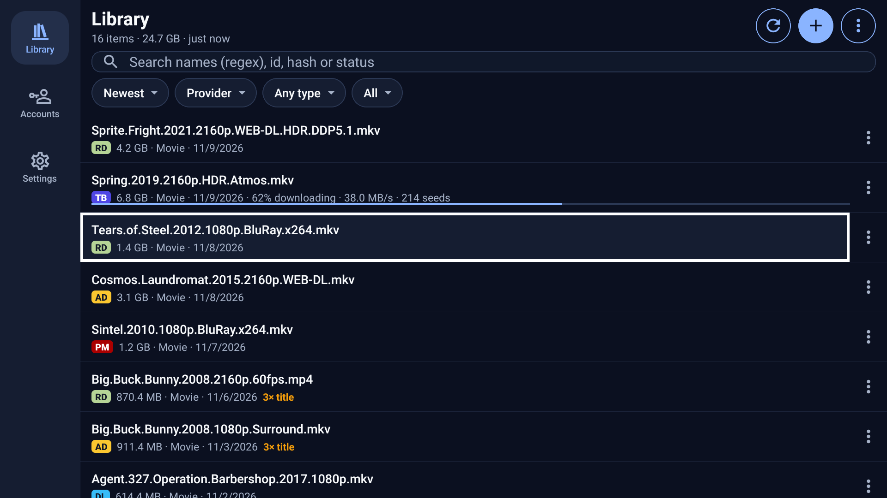</a>
<a href="docs/screenshots/firetv-detail.png">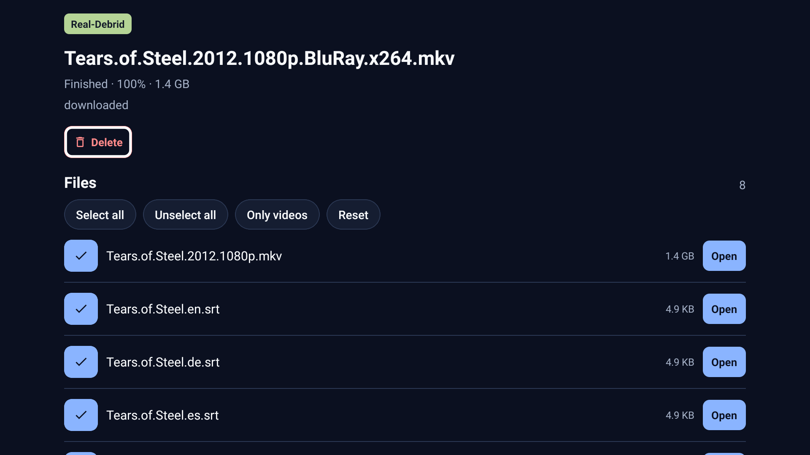</a>
<a href="docs/screenshots/appletv-library.png"></a>
<a href="docs/screenshots/appletv-menu.png">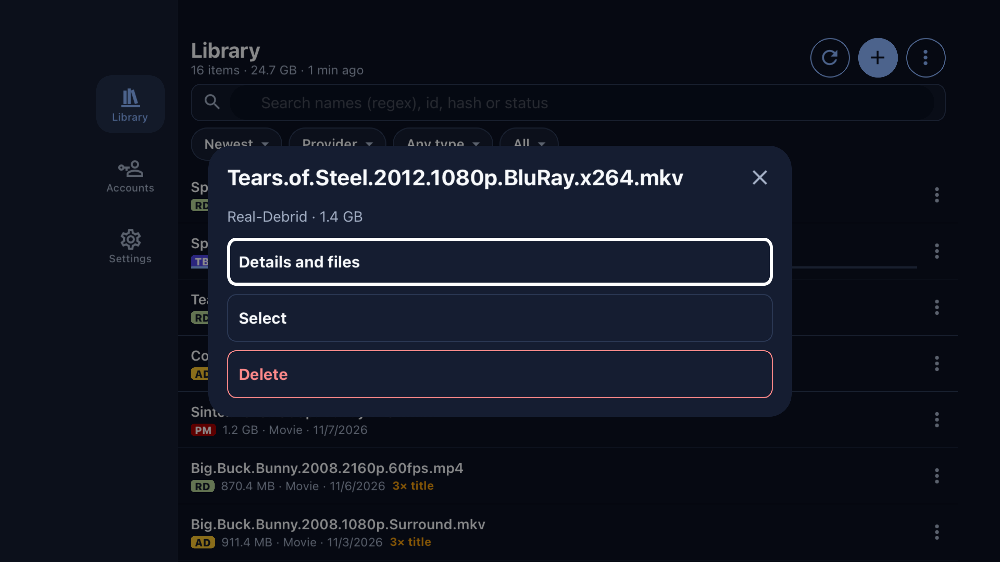</a>
<a href="docs/screenshots/appletv-select.png">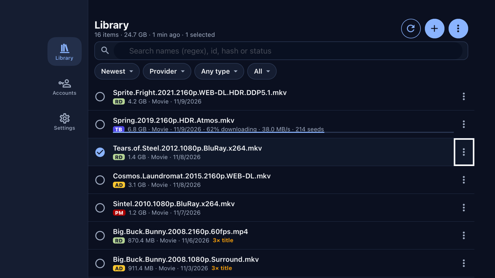</a>
</p>

### Tested on the device (2026-11-09)

| Provider | Result |
|---|---|
| Real-Debrid | Device sign-in approved in the browser, library, add magnet, file selection, open a file |
| Premiumize | Device sign-in approved, library |
| Debrid-Link | Device sign-in approved (the delete scope is listed), library |
| AllDebrid | Pasted key and library; the PIN is created and shown on AllDebrid's page, approval not completed in this test |
| TorBox | Pasted key and library; a free-plan key is refused |
| Offcloud | Pasted key, library, provider filter, open a file (sizes show as unknown: Offcloud's history and file list carry none) |

On TVs (2026-11-09): the Fire TV Cube signed in by scanning its QR code with a
phone, then the library, remote navigation, search with the on-screen keyboard
and opening a file were tested. The Apple TV simulator signed in the same way
and was driven with the remote. A real Apple TV has not been tested yet.

This project is distributed under AGPL-3.0-only. See `LICENSE` and `NOTICE.md`.

For a populated preview without provider credentials, use the [fixture QA entry](qa/README.md) in a separate checkout.

An embedded player, background downloads and store distribution are outside
this release. The pinned Expo CLI has five moderate transitive development-tool
advisories; no incompatible forced dependency downgrade was applied.
