# DMM Mobile features in detail

The [README](../README.md) has the short version. This page has the details of
each feature, how it talks to each service, and what was tested on which device.
Building and releasing the app is in [development.md](development.md).

DMM Mobile shows your existing DMM library on native screens on iPhone, iPad,
Apple TV, Android phones and tablets, and Android TV / Fire TV. It talks to each
provider from the device; the DMM web app and its server-side session are not
required.

## Signing in

The app opens on a sign-in screen until at least one provider is connected.

On a TV the sign-in is a QR code, as for DMM's Kodi addon: scan it with a
phone signed in to DMM (or open debridmediamanager.com/tv and type the code),
approve, and that browser's debrid logins and settings come to the TV. Phones
and tablets sign in per provider:

| Provider | Sign-in | Paste a key |
|---|---|---|
| Real-Debrid | Device code (OAuth); the token renews itself every 24 hours | API token |
| AllDebrid | PIN, which hands back an API key | API key |
| Premiumize | Device code (OAuth); the token lasts ten years | API key |
| Debrid-Link | Device code (OAuth); the token renews itself daily | API token |
| TorBox | none offered by TorBox | API key |
| Offcloud | none offered by Offcloud | API key |

"Sign in with …" shows a short code and opens the provider's approval page in
the browser; the app finishes on its own once the code is approved. The client
ids are the public ones DMM web uses, and the app calls the providers directly.
Every credential is checked with a read-only account request before it is
saved, and free or lapsed accounts are refused the way DMM web refuses them
(TorBox free plan, non-premium Premiumize, Offcloud and Debrid-Link).

Credentials are kept only in the platform secure store. Disconnecting a
provider deletes its secure-store item and invalidates outstanding requests
before clearing that provider's library rows.

The demo key `dmmdemo` works as any provider's API key and opens a sample library
of open movies without a debrid account.

## Home

The first tab once signed in: rows of posters of what the library holds. Rows
with nothing in them are hidden.

- **Continue Watching**: files left part way in the built-in player, latest first,
  one per film or show; with Trakt or Simkl connected, also what you left part way on
  another device, when the library holds it. A tap resumes at once; press and hold to remove one, mark it
  watched or go to its page.
- **Next Up**: for each show with a watched episode, the next episode the library
  holds that is not watched yet (after the one watched last, never a special), from
  the release played before when it has it. A tap plays it.
- **Watchlist**: with Trakt or Simkl connected, Trakt's watchlist and Simkl's Plan to
  Watch together, each title once, what the library holds first ([Lists](#lists)).
- **Upcoming**: the next episode of each of your shows ([Calendar](#calendar)), soonest first.
- **Recently Added**: the newest films and shows.

**Watched** is kept per title, not per copy: a film by its IMDb id, an episode by
its show's id, season and number, so any release or provider of it counts. A video
counts once the built-in player reaches 80% of it; films, episodes and whole seasons
are also marked by hand on the title page (an episode's check mark; press and hold
it for "Mark watched up to here"). Posters show a check once watched and a bar while
part watched (a show also says "3 of 10"), episodes the same, and season chips their
count. Without Trakt or Simkl, **watch state stays on this device** (`src/watched.ts`);
with either connected it follows you ([Trakt](#trakt), [Simkl](#simkl)).

## Library

The library opens on **Titles**: your films and shows as posters, each one
once however many releases and providers hold it. DMM names each release (its
library identification, the answers DMM web's library page uses; the app proves
one of its provider logins to ask), and the phone remembers the answers, so a
refresh asks only about new releases. A film's page lists your copies with Open;
a show's page lists its seasons and the episodes you have, each copy with Open,
reading episode numbers from the file names (SxxEyy, 1x02, a season folder or
the release's one season). Files with nothing to go by, such as absolute anime
numbering or extras, stay on the show's page under "Not placed". Releases DMM
cannot name stay below the posters as Other. Only what is in your library shows:
finding new releases stays on DMM web.

### What's in each copy

Each copy says what ffprobe found in it when DMM has a probe of the file (from
zurg or a sponsor's app; the app asks once per release and keeps the answer):
"4K · DV P8.1 + HDR10 · HEVC 10-bit · 61.2 GB" over "TrueHD Atmos 7.1 · EN, JA ·
Subs EN, ES +3", with the best audio track. Tap it (Select on a TV) for every
audio and subtitle track with its language, codec, channels and default,
forced and SDH flags, the video bitrate and the runtime. A copy without a probe
keeps the resolution and tags of its name. HDR10+ hides in frame data a stream
probe cannot see, so it comes from the release name, and so does any HDR tag a
probe is silent about.

### Torrents

**Torrents** is the library page of DMM web, on the phone. One dense list across every
connected provider, one row per item, built for libraries of thousands
(measured with 7,205 items on a Pixel 6: a full refresh of six providers in
about 6 s, smooth scrolling, search under a second per keystroke).

- **Search** like DMM web: every word must match the name (as a pattern), an
  id, a provider prefix such as `rd:`, an info hash or a provider status.
- **Filters**: provider, movies / TV / other, and the web's views (in
  progress, slow, failed, uncached, names Real-Debrid blocks, same hash, same
  title, selected). Sort by newest, oldest, title, size or progress.
- **Rows** show the provider, size, type, date, progress and speed, and how many
  copies share the hash or title; a row's ⋯ menu opens just that group, and has
  the row's own actions.
- **Selection and bulk actions**: long press selects. Actions take the
  selection, or everything shown when nothing is selected: reinsert, delete,
  share a hash list, back up, delete duplicates (keep the bigger, smaller,
  newer or older) and merge copies of one hash.
- **Add** magnets, info hashes (Debrid-Link only when cached), `.torrent` files
  and, on TorBox, web links. `magnet:` links and `.torrent` files opened from
  other apps (Open with, a browser download) land in Add, on the provider used last.
- **Backup and restore** use DMM web's `.dmm.json`, so either side restores the
  other's; TorBox and AllDebrid can restore only what is cached.
- **Item detail**: files, open a file in another app, share its links, reinsert
  (Real-Debrid; active TorBox torrents; failed AllDebrid magnets), and choose
  Real-Debrid files, including on a finished torrent.

Download links are resolved only after a user taps a file. Videos play in the
app's built-in player (below) unless another is chosen in Settings (VLC, MX
Player, Just Player or Android's app picker; Infuse, VLC, VidHub, Outplayer,
SenPlayer or Aether on iOS), the same list DMM web offers; other files go to the
operating system. Hash lists open on DMM web's `/hashlist` page, carried
in the link itself.

## Built-in player

libVLC 3 (through `@lunarr/vlc-player`), so the files debrid services hold play as
they are: MKV and MP4, H.264 and HEVC (10-bit too; HDR plays but shows as SDR),
AC3, E-AC3 (Atmos too), DTS (DTS-HD MA and DTS:X too), TrueHD (Atmos too), FLAC,
Opus and PCM audio, and SRT, ASS and PGS subtitles. Full screen and landscape
(the rotate button turns a phone to portrait and back).

- **Controls**: play/pause and 10-second skips in the middle, the seek bar, and
  above it the title's logo (metahub; its name when there is none), the episode
  ("S1 E2 • title", titles from Trakt's public season list) or the film's year,
  badges for the copy that plays (resolution, HDR or Dolby Vision, bit depth,
  codecs, channels, REMUX/WEB-DL, container, MULTI and the language playing, from
  DMM's stored ffprobe data and the release name) and when it ends at the current
  speed. The toolbar: next episode, subtitles and audio (the tracks inside the
  video, then subtitle files of the same release), speed (0.5x to 2x), episodes,
  and behind › picture size (fit, fill, original on Android, 16:9, 4:3), other
  versions (another copy of the same film or episode, from where this one is),
  a sleep timer (end of the episode or film, 15, 30 or 60 minutes; it carries on
  into the next episode) and audio and subtitle delay. Tablets and TVs show the
  whole toolbar at once.
- **Chapters**: a file with chapters (most Blu-ray remuxes) shows the playing
  chapter's name above the seek bar on the left ("Chapter 06" when the file names
  none), a mark on the bar where each one starts, and a Chapters list in the
  toolbar (behind › on phones) to jump to one. Files without chapters show nothing
  extra.
- **Picture in picture** (Android phones and tablets): the button left of rotate
  keeps the video playing in a small window over other apps, with its own
  play/pause button. Resume points, scrobbling and the sleep timer carry on there;
  the window's expand button brings the player back, and closing the window
  pauses it where it was. At the end of an episode the next one waits for the
  player to come back (its countdown then runs). Not on iPhone and iPad (the
  VLCKit 3 player has no picture in picture) or TVs.
- **Lock**: hides everything but one unlock button; touches neither seek nor pause.
- **TV**: the remote moves from the middle buttons down to the seek bar (left and
  right skip there) and the toolbar; play/pause and skip keys work, left and
  right skip 10 seconds while the controls are hidden, and Select shows them. No
  rotate or lock on a TV.
- **Resume**: where each file was left is kept on the device (provider, release
  hash and file path), saved every 5 seconds and on leaving; opening it again
  offers to resume or start over. From 80% a file counts as watched and starts
  from the beginning (`src/playback.ts`), as on Trakt and Simkl.
- **Next episode**: when an episode ends and the library has the next one (the
  next number in the season, else the next season's first), it starts after a
  10-second countdown, from the same release or provider when it can.
- A file that does not play, a stream that stops for 30 seconds, or a video whose
  sound the player cannot decode offers Try again (from where it stopped) and Open
  in another app.
- On a Fire TV the first video after installing takes about half a minute to
  start while libVLC indexes the system fonts; later ones start in 2 to 5 seconds.

DMM web knows only its own players, so choosing the built-in player is kept on
the device and not sent to DMM; a player app chosen here is.

On iPhone, iPad and Apple TV the player is our own VLCKit build with FFmpeg's
TrueHD decoder switched back on, since VideoLAN's builds play TrueHD-only files
silent there. How it is built and checked is in
[development.md](development.md#the-players-vlckit-on-iphone-ipad-and-apple-tv).

## Trakt

Settings → Trakt. Someone already signed in to Trakt on DMM web (with "Remember my
logins and settings across devices") is signed in here too without asking; anyone
else presses Connect and approves a code on trakt.tv (a QR code on a TV). Once
connected, all of this is automatic, with no switch to turn on:

- **Scrobbling**: the built-in player tells Trakt what plays, pauses and stops
  (a film by its IMDb id, an episode by its show's id, season and number), so Trakt
  shows it as watching.
- **One threshold, 80%**: a video counts as watched from 80%, in the app and on
  Trakt alike. Trakt marks a stop from 80% watched and refuses a pause there
  (`422 progress_too_high`), so the app sends a pause before 80% (Trakt keeps it as
  a resume point) and a stop from 80%.
- **Watched history, both ways**: marks made by hand (films, episodes, whole
  seasons) go to Trakt's history and unmarking removes them there; what other
  devices and apps marked comes back. The app reads `/sync/last_activities` when
  it starts and when it comes back to the foreground (at most once a minute), and
  downloads the history only when that moved. The first time, both histories join:
  what only this device had goes to Trakt, and nothing is removed from Trakt.
  Films or episodes Trakt does not know stay watched on the device only.
- **Resume from another device**: Trakt's resume points (`/sync/playback`) show
  under Continue Watching for titles the library holds, and opening the file
  starts there, whichever of this device's and Trakt's is newer.
- **Offline**: whatever does not reach Trakt is kept on the device and sent later:
  a finished video as a dated history entry, a pause as a pause. Trakt takes one
  write a second, so writes queue.

The tokens are DMM's Trakt app's, the same as DMM web's, kept in the secure store
and in the "remembered across devices" copy under DMM web's `trakt:*` keys. DMM
holds the app's client secret, so linking and renewing go through DMM
(`/api/kodi/tracker/*`, as for the Kodi addon). A token lasts 7 days, and Trakt
accepts each refresh token only once. So the app renews only in a token's last
hour, first takes a newer login that DMM web or another device saved, and saves
its new one across devices at once. A renewal leaves the old access token
working, so a DMM web tab that is already open keeps its own login until it
expires; a browser that signs in afterwards gets the renewed one. Disconnect
forgets Trakt here and in the remembered copy, and a login disconnected here is
not taken back from DMM web's copy (a newer sign-in is). It does not revoke the
token, which DMM web may be using. The demo key never reaches Trakt. DMM Mobile
uses Trakt but is not endorsed or certified by Trakt.

Trakt's free accounts can do all of this: none of these endpoints is VIP-only, and
the account limits (lists, watchlist, collection) do not touch history or
scrobbling. Trakt allows 500 reads per 5 minutes and one write a second per user.

Tested on 2026-11-12 with a Trakt test account (Pixel 6, Fire TV Cube, iPhone 15 Pro):
DMM web's login picked up silently on the Pixel and at an iPhone sign-in;
device-code connect on the Pixel and by QR on the Fire TV; scrobbling (watching,
then watched at 80% with one play); a pause on the Pixel resumed at the same
place from the iPhone's Continue Watching; a season marked, unmarked and an
episode unwatched on Trakt, both ways on the Pixel; a renewal on the Fire TV
written back and taken by the Pixel and a fresh DMM web browser; Disconnect.

## Simkl

Settings → Simkl → Connect, then approve the code on simkl.com/pin (a QR code on a
TV). Once connected it works like Trakt, with no switch to turn on: scrobbling with
the same 80% line, marks and unmarks sent to Simkl's history, what other apps marked
coming back, Simkl's resume points under Continue Watching, and whatever cannot be
sent kept for later. With Trakt and Simkl both connected, what plays here and every
mark made here goes to both, and a film or episode either one lists counts as
watched. Neither one's own history is copied into the other: connecting Simkl sends
it what this device marked, not what came from Trakt.

- **Its own login on each device.** DMM's Simkl app is a public client, so the app
  links, renews and calls Simkl itself (`src/simkl.ts`), without DMM. Simkl keeps one
  live access token per grant and a renewal ends the previous one, so a login shared
  between devices would sign them out of each other; it stays in this device's
  secure store and is not part of the "remembered across devices" copy. DMM web's
  Simkl login (custom lists) lives in DMM's server session and cannot be used here.
- **Write access.** The app asks for `media:read media:write`. DMM's Kodi link asks
  for read only, and Simkl refuses every write from such a grant (`403
  insufficient_scope`). Should Simkl ever grant read only, Settings says so: marks
  then come from Simkl and nothing is sent until you connect again.
- **Its rules.** At most one write a second; the app checks Simkl's activity stamps on
  start and coming back at most every 15 minutes (any time on pull to refresh) and
  downloads the history only when they moved. No call after a seek (Simkl moves its
  progress by itself). Free accounts have 500 requests a day (PRO 1,000, VIP 10,000);
  past that, the app waits until Simkl's allowance resets and then sends what waited. Anime is sent
  and read by the show's IMDb id and its usual season numbers; Simkl maps them to its
  own per-season entries. Tokens last 7 days and renew in their last hour; Disconnect
  revokes the grant. The demo key never reaches Simkl.
- **Attribution.** Settings names Simkl, links to simkl.com and says DMM Mobile is not
  affiliated with Simkl, and a title's page has "View on Simkl" while Simkl is
  connected (not on a TV, which has no browser), as Simkl's API rules and terms ask.

Tested on 2026-11-12 with a Simkl test account, alongside the Trakt one (Fire TV Cube,
Pixel 6): connect by QR on the Fire TV and by code on the Pixel; the first import
joining both histories with nothing copied across; an episode played past 80% on the
Fire TV, watched on Simkl and Trakt; a season unmarked and marked again from the TV on
both; a film and a season marked and removed on Simkl showing up on both devices;
Disconnect. Not yet on an iPhone or Apple TV (same code; the iOS bundle builds).

## Lists

With Trakt or Simkl connected, Home has a list button (on a TV, right of the Home tab)
that opens **Lists**: Trakt's watchlist, your own lists and the lists you liked, and
Simkl's Plan to Watch, Watching, On hold, Completed and Dropped, each with how many of
its titles the library holds. A list opens as posters; what the library lacks is dimmed.

- **In the library** (matched by IMDb id, films and shows alike): the title's page, to
  play it.
- **Not in the library**: what it is (poster, year, plot from DMM) and **Open on DMM**,
  which opens its DMM page in the browser signed in as the app (as [Search](#search) does). Finding
  releases stays on DMM web; the app lists none. A TV, which has no browser, shows a QR
  code of the plain DMM page instead, to open on a phone (never with a sign-in code in
  it: that would sign the phone in with the TV's logins).
- **Kept on the device and read only when they change.** Trakt's lists are read again
  when `/sync/last_activities` says the watchlist or your lists moved (checked at most
  once a minute: on start, coming back to the app or to Home, and pull to refresh), and
  once an hour or on pull to refresh for lists you liked, which their owners change. A
  list's items are downloaded again only when its `updated_at` moved. Simkl's statuses
  come in the same answer as its watched history, read when its activity stamps move, so
  they cost no extra requests (Simkl allows free accounts 500 a day). Lists are not
  read with the demo key, and go when a tracker is disconnected.
- Simkl's own custom lists are left out: Simkl serves their items to PRO and VIP
  accounts only (a free account gets `premium_only`). Adding and removing list items is
  not in the app yet.

Tested on 2026-11-12 with the Trakt and Simkl test accounts (Pixel 6, Fire TV Cube): no
tracker, then Trakt alone, both (the two watchlists joined, each title once) and Simkl
alone; Trakt's watchlist, a private list and a liked list, Simkl's statuses; a title the
library holds played from a list; Open on DMM landed signed in on the Pixel; the Fire TV's
QR code holds the plain page; a list changed on Trakt and a status moved on Simkl showed
after pull to refresh. Not yet on an iPhone or Apple TV (same code; the iOS bundle builds).

## Calendar

Home's calendar button (on a TV, right of the Home tab) opens the episodes of **your shows**: what airs today and
in the next 30 days, or what aired in the last 7, by day in the device's time zone, each with its time. Your shows
are the shows in the library, the ones Simkl lists as watching or plan to watch, and, with Trakt connected, the
ones Trakt's own calendar lists (what you watched, your watchlist and collection).

- **In the library** (any copy whose file names hold that season and episode, a two-episode file too): it plays,
  with the watched tick as everywhere else.
- **Aired, not in the library**: **Open on DMM** opens the season's DMM page in the browser signed in as the app (as
  Search does); a TV shows a QR code of the plain page instead.
- **Still to come**: its date and time; a tap opens the show.

Where the dates come from, and how often (measured 2026-11-12):

- **Trakt connected**: `/calendars/my/shows` for the whole window, one request, read again after 6 hours or on pull
  to refresh (at most once a minute). Its answer decides for every show it lists.
- **Every other show**: DMM's `/api/info/show`, which gives a show's last and next episode, then, when either falls
  inside the window, those seasons from Trakt's public season list (`/shows/<id>/seasons/<n>?extended=full`, no login),
  which has every episode's air time. A show airing now is checked again twice a day, one between seasons weekly, an
  ended one monthly; answers are kept on the device (`calendar-v1.json`), so a start or a pull to refresh reads only
  what is due. The first look at a big library reads each show once, four at a time.
- **Simkl**: no requests at all: its watching and plan to watch shows come from the lists already read ([Lists](#lists),
  above). Simkl's public calendar files cost no requests either, but its TV file is 2.7 MB (477 kB compressed) and
  its anime file carries no IMDb ids to match a library by, so the app does not read them.
- DMM's `/api/calendar` is a global Trakt calendar (about 340 popular shows a month): it misses most libraries' shows,
  so it is not used.
- The demo key has no shows (its titles are films) and never reaches a tracker: its calendar is empty.

**New-episode alerts** (phones and tablets; Settings → New-episode alerts, off until switched on, which is when the
app asks for permission to notify): a local notification when an episode of your shows airs, or at 9:00 on its day
when only the date is known. Each calendar update schedules the next 60 (iOS keeps 64 per app) and cancels those
that left or moved; switching alerts off cancels them all. Nothing runs in the background and no server sends
anything: alerts already scheduled fire with the app closed, and the next ones are scheduled the next time the app
opens. Android may deliver one up to an hour after the air time: without the exact-alarm permission, which the app
does not ask for, it batches alarms (measured on the Pixel 6: a window of three quarters of the wait, at most an
hour); an alert that is due but not shown yet is left to fire. On Android the alerts are the app's own module
(`modules/dmm-alerts`: an alarm per alert, kept on the device so a restart, an app update or a force stop can set
them again). Since 1.2.1 Android builds leave out `expo-notifications`, which would bring Firebase Cloud Messaging
for push the app does not use, and the `expo-application` it pulls in, which brings Google's Play Install Referrer
library (`package.json`, `expo.autolinking`): the APK has no Firebase or Google Play services code. Its permissions
are `POST_NOTIFICATIONS` (asked only when alerts are switched on) and `RECEIVE_BOOT_COMPLETED` (so scheduled alerts
survive a restart). iOS uses `expo-notifications` with no push entitlement. Both are native code, so they ship with
a store release, not over the air.

Tested on 2026-11-12 with the Trakt and Simkl test accounts (Pixel 6, Fire TV Cube, iPhone simulator): a library show
alone (The Simpsons, from DMM and Trakt's season list), then Trakt's watched and watchlisted shows and Simkl's watching
and plan to watch ones on the same calendar; an aired episode opened on DMM signed in, added to Real-Debrid there and,
after a pull to refresh, played from the calendar; the watched tick; on the Fire TV the calendar with the remote and a
QR code holding the plain DMM page; alerts switched on (Android 13's and iOS's permission prompts), 19 scheduled on the
Pixel, none after switching off; a notification firing on time on the Pixel and the iPhone simulator from a test build
with an episode faked two minutes ahead (the test change is not in the repository). Not yet on an iPhone or Apple TV.

The Android module was tested on 2026-11-14 on the Pixel 6 (Android 16): switching alerts on asked Android's
permission and set an inexact alarm per episode (7), switching off removed them all, a test build's fake episode
posted its notification with the app in the background, and the alarms came back after a force stop both from a
`BOOT_COMPLETED` broadcast and from the next app start. The Fire TV Cube started and has no alerts setting.

## Search

DMM web's quick search on its own tab: the six best movie and show matches,
then up to three anime. A row opens that title's page on DMM in the phone's
browser, already signed in with the app's logins: the app hands them to DMM
behind a one-time code that lives two minutes, carried in the link's `#`
fragment, which never reaches a server. A browser that is already signed in to
DMM keeps its own login. Pasting an IMDb id opens that title directly.

## Remembered across devices

Always on. The app keeps your logins and settings in DMM's "remember my logins
and settings across devices" store, behind each provider login, in DMM web's own
format. Sign in to one provider (in the app or on DMM web with that option
ticked) and the other logins and settings come back; keys DMM web keeps that the
app does not use are saved back untouched. Anyone who can sign in to one of
those accounts gets all of them, so keep shared debrid accounts out of the app.
Settings (video player, the provider adds start on) use DMM web's
`settings:player` and `settings:addMagnetProvider`; the built-in player and
"Browser or default app" stay on the device, as DMM web has neither.

Not in the app, because they need DMM's servers: casting from DMM web, sending
to Real-Debrid through DMM's uploader and the media info panel.

## Tablets and TVs

On a tablet or TV the tabs become a rail on the left and sheets float in the
middle. On a TV the rail is a slim column of icons, and the focused one shows
its name beside it. On a TV everything is reached with the remote: the focused control is
outlined, Select opens a text field's keyboard (Android TV otherwise keeps the
remote inside a focused field), and the dark theme is always on. Apple TV draws
the Android TV layout at twice the size, so both look the same. What a TV has
no way to do is left out: sharing, file pickers, opening links in a browser,
and so the Search tab.
On Apple TV videos play in the built-in player, or in a player app chosen in
Settings (Infuse, VLC and the rest of DMM web's list).

## Screenshots

Release builds (click one to open it). The libraries show Blender open movies
(CC BY) from a screenshot fixture of the real screens; the two sign-in screens are
the app as it ships. Tears of Steel's media details come from probes the fixture
builds from the film's real streams (its 5.1 mix, 22 subtitle languages), with the
HDR its release names claim. The player plays Blender's own Sintel 1080p MKV, whose
eight chapters are the file's; its badges come from the fixture's release name.
There is no Search shot: its results are DMM's live search, with commercial posters.
The store slides and previews in `docs/store/marketing/` are made from the same
fixture ([listing.md](store/listing.md)).

### Phones

Pixel 6 (Android 16) and iPhone 17 Pro simulator (iOS 26.5).

<a href="screenshots/android-phone-home.png">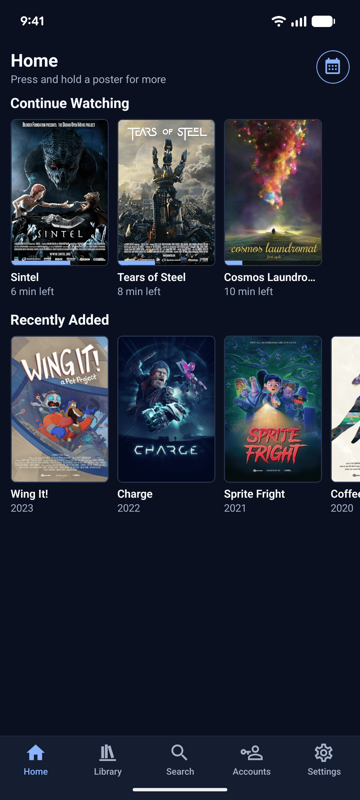</a>
<a href="screenshots/android-phone-library.png">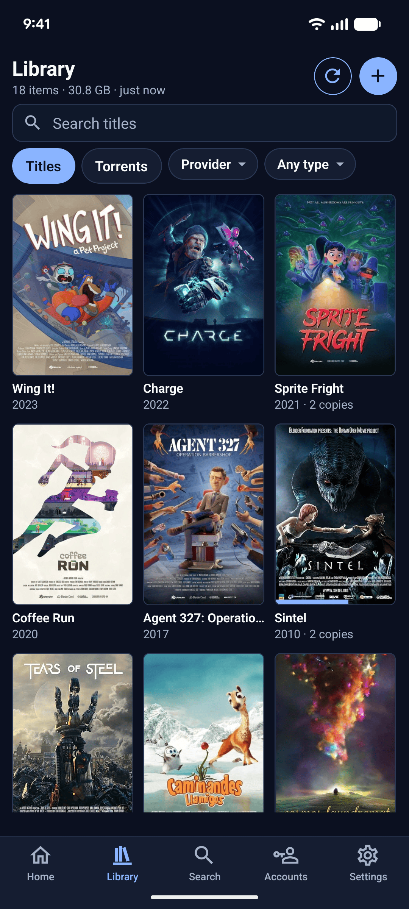</a>
<a href="screenshots/android-phone-title.png">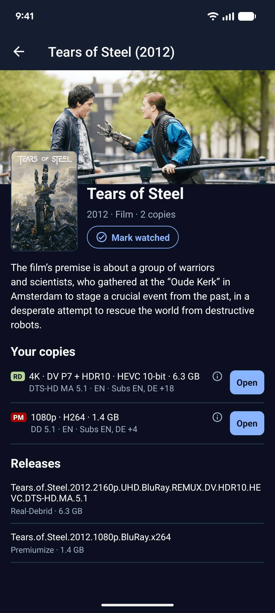</a>
<a href="screenshots/android-phone-copy-details.png">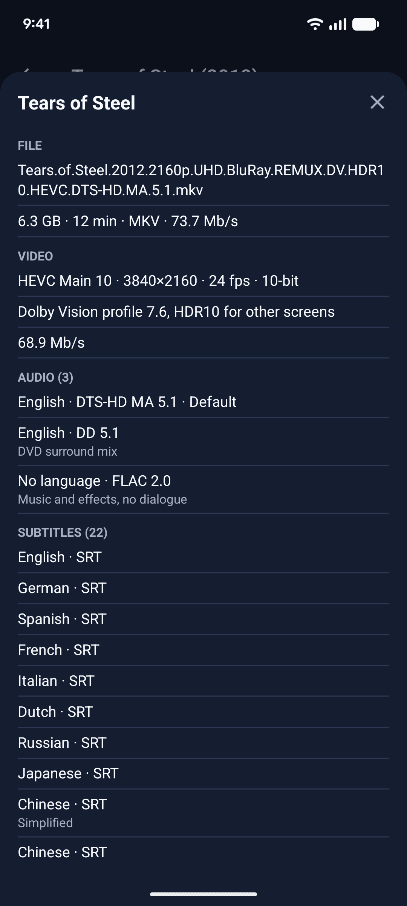</a>
<a href="screenshots/iphone-title.png">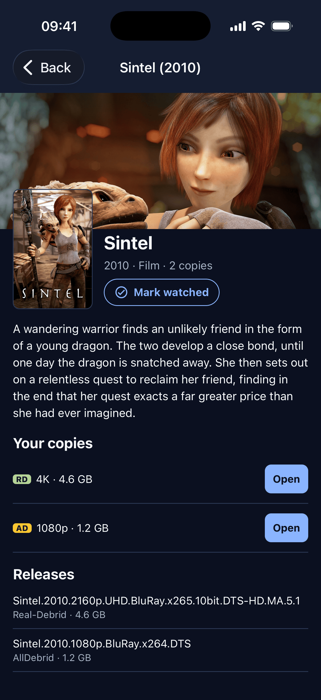</a>
<a href="screenshots/iphone-sign-in.png">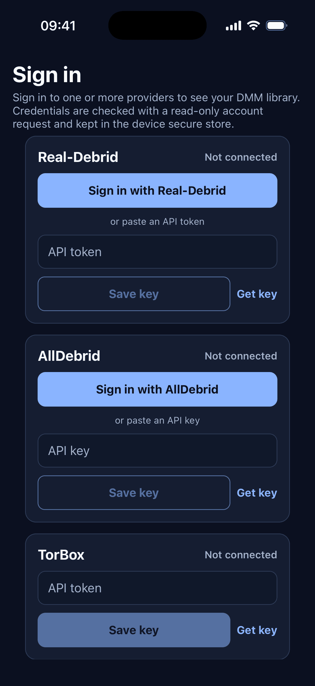</a>

<a href="screenshots/android-phone-player.png">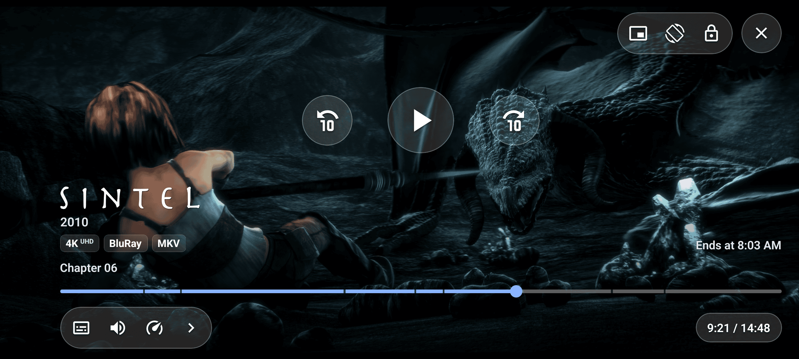</a>

### Tablets

Pixel 6 set to a 10-inch tablet's screen (2560×1600) and iPad Pro 13-inch simulator.
The tabs become a rail on the left.

<a href="screenshots/android-tablet-home.png">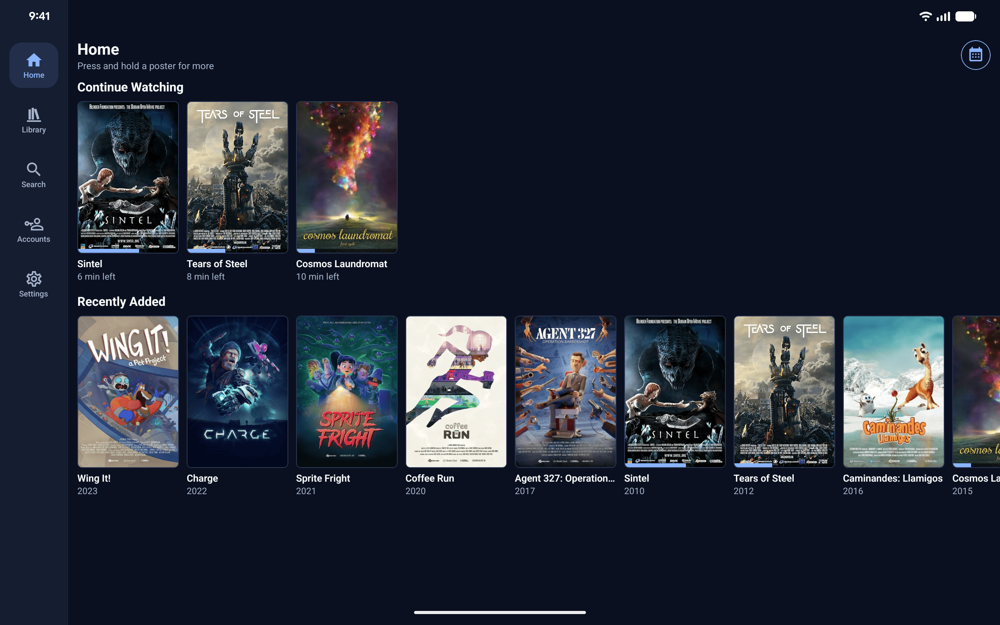</a>
<a href="screenshots/ipad-library.png">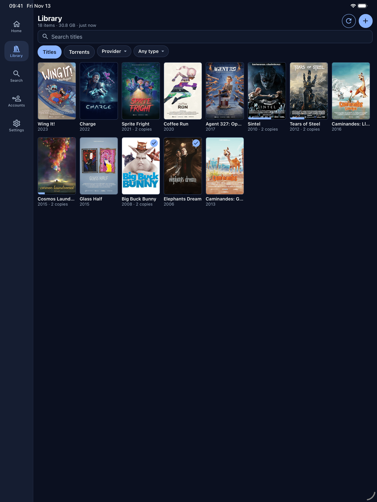</a>

### TVs

Fire TV Cube (Fire OS 7, 1080p) and Apple TV 4K simulator (tvOS 26.5, saved at
1080p). The focused control is outlined; a TV signs in by scanning a QR code with a phone.
TVs have no Search tab, since a TV has no browser to open results in.

<a href="screenshots/firetv-sign-in.png">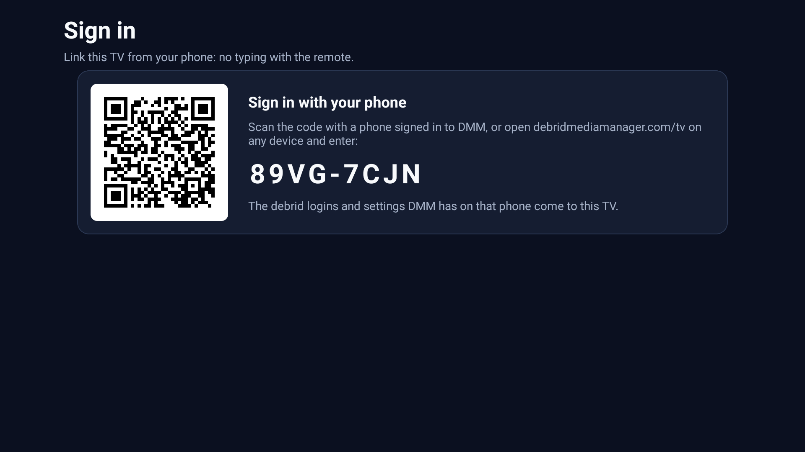</a>
<a href="screenshots/firetv-home.png">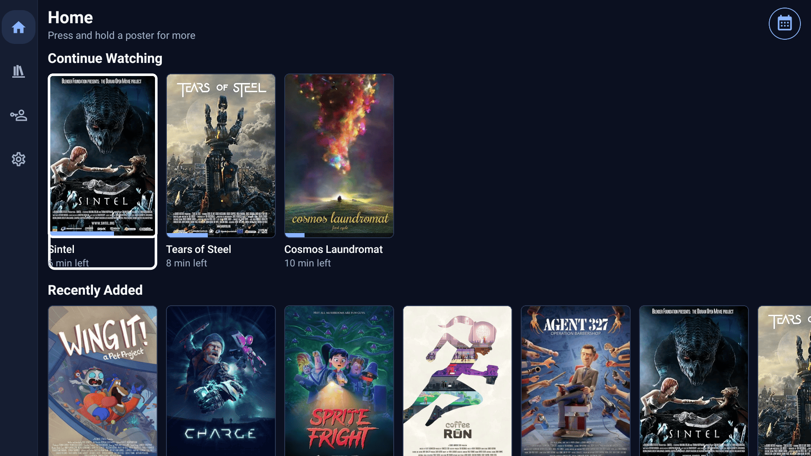</a>
<a href="screenshots/firetv-library.png">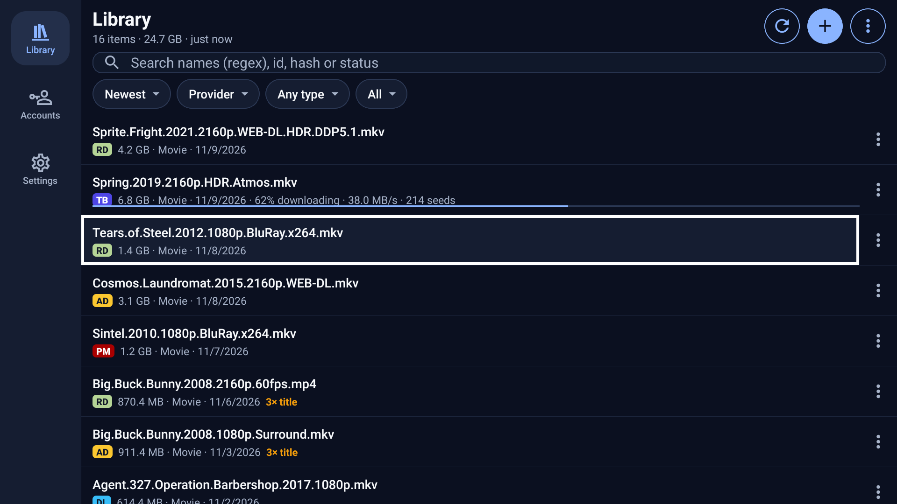</a>
<a href="screenshots/firetv-title.png">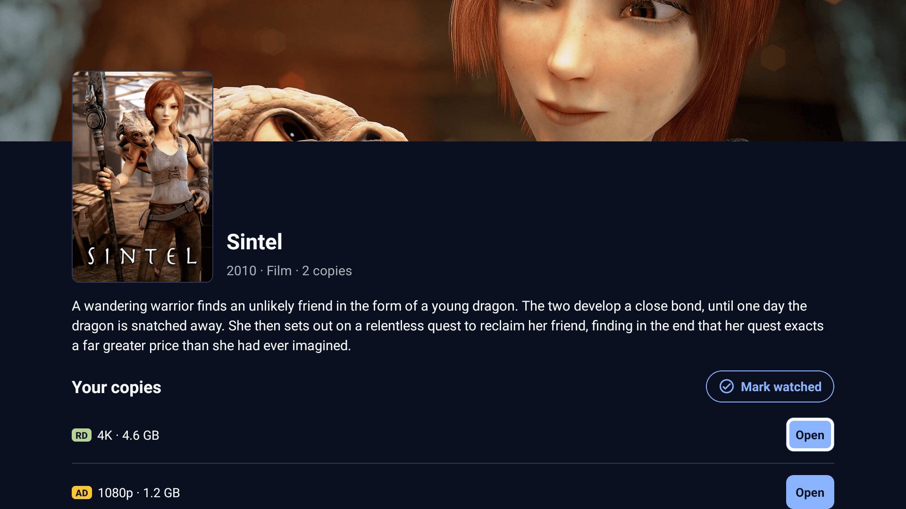</a>
<a href="screenshots/appletv-home.png">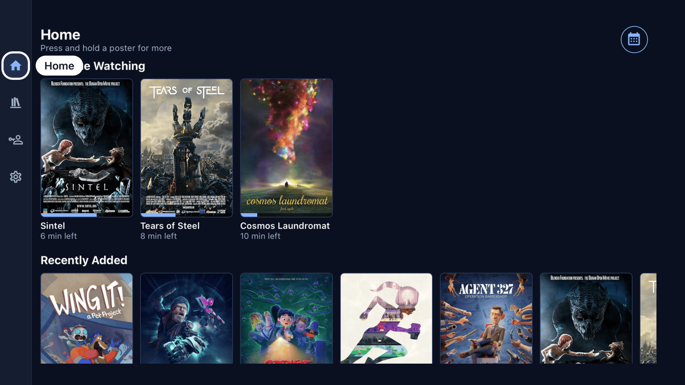</a>
<a href="screenshots/appletv-library.png">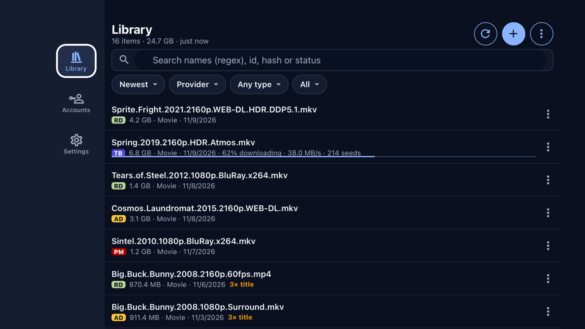</a>
<a href="screenshots/appletv-title.png">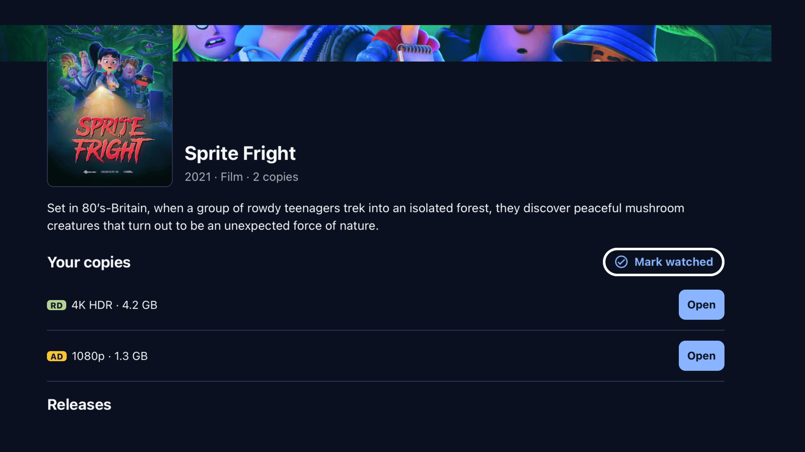</a>

## Tested on the device (2026-11-09)

| Provider | Result |
|---|---|
| Real-Debrid | Device sign-in approved in the browser, library, add magnet, file selection, open a file |
| Premiumize | Device sign-in approved, library |
| Debrid-Link | Device sign-in approved (the delete scope is listed), library |
| AllDebrid | Pasted key and library; the PIN is created and shown on AllDebrid's page, approval not completed in this test |
| TorBox | Pasted key and library; a free-plan key is refused |
| Offcloud | Pasted key, library, provider filter, open a file (sizes show as unknown: Offcloud's history and file list carry none) |

On TVs (2026-11-09): the Fire TV Cube signed in by scanning its QR code with a
phone, then the library, remote navigation, search with the on-screen keyboard
and opening a file were tested. The Apple TV simulator signed in the same way
and was driven with the remote. A real Apple TV 4K (tvOS 26.6) was tested on
2026-11-13: the built-in player, TrueHD reaching the receiver, Trakt, Lists and the Calendar.

Background downloads are outside this release.
